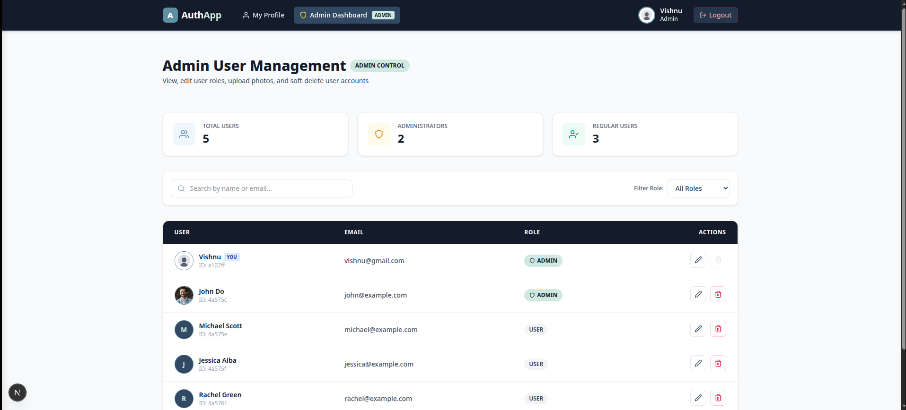

# Full-Stack Node.js & Next.js Authentication and User Management App



A production-grade authentication and user management (CRUD) application with role-based access control (User and Admin) built from scratch using Node.js, Express, MongoDB, Next.js 16 (App Router), TypeScript, Tailwind CSS v4, and TanStack Query.

---

## Features

### 1. Authentication & Security
- **Registration & Login**: Secure credential authentication with passwords hashed via `bcryptjs`.
- **JWT Authorization**: Stateless session authorization via Bearer tokens (`jsonwebtoken`).
- **Route Protection**: Middleware guards (`protect` and `adminOnly`) preventing unauthorized API access and auto-redirecting unauthenticated users on the client side.

### 2. User Capabilities
- **View Profile**: Real-time display of user info, role badge, and current profile photo.
- **Edit Profile**: Update full name with validation feedback.
- **Avatar Upload**: Upload profile pictures (`jpg`, `jpeg`, `png`, `webp` up to 5MB) with instant client-side preview, stored locally via `multer` and served statically.

### 3. Admin Dashboard & User Management
- **User Directory**: View all active accounts across the system.
- **Search & Filter**: Real-time filtering by user name, email, or account role (`All`, `Users Only`, `Admins Only`).
- **Interactive Pagination**: Modular pagination footer with page buttons, previous/next controls, and a configurable `Per page` selector (`3`, `5`, `10`, `20`).
- **Edit User**: Admin can update a user's name, email, role, and upload a new profile photo directly.
- **Admin Self-Protection**:
  - **Self-Demotion Guard**: An active admin cannot demote or alter their own role (locked in UI and rejected by backend).
  - **Self-Deletion Guard**: An active admin cannot delete their own account.
- **Soft Delete with Confirmation Modal**: Non-destructive deletion (`isDeleted = true`) with a custom confirmation modal dialog (no native browser popups).

---

## Tech Stack

### Backend
- **Runtime**: Node.js (ES Modules `"type": "module"`)
- **Framework**: Express.js
- **Database**: MongoDB with Mongoose ODM
- **Authentication**: JSON Web Tokens (`jsonwebtoken`) & `bcryptjs`
- **File Uploads**: `multer`
- **CORS**: `cors`

### Frontend
- **Framework**: Next.js 16 (App Router)
- **Language**: TypeScript
- **Styling**: Tailwind CSS v4 (`@theme` custom palette with consistent `cursor: pointer` interactions)
- **Server State**: `@tanstack/react-query` (data caching, invalidation, mutations)
- **Client State**: React Context (`AuthContext` for session persistence in `localStorage`)
- **HTTP Client**: Axios with centralized token interceptors
- **Icons**: `react-icons` (Feather Icons)

---

## Project Structure

```
node-auth/
├── backend/
│   ├── config/
│   │   └── db.js                 # MongoDB connection setup
│   ├── controllers/
│   │   ├── authController.js     # User registration and login
│   │   └── userController.js     # User profile and admin CRUD
│   ├── middleware/
│   │   ├── authMiddleware.js     # JWT verification & admin-only guard
│   │   └── uploadMiddleware.js   # Multer storage, limits & file filters
│   ├── models/
│   │   └── User.js               # Mongoose schema, bcrypt pre-save, methods
│   ├── routes/
│   │   ├── authRoutes.js         # /api/auth routes
│   │   └── userRoutes.js         # /api/users routes
│   ├── uploads/                  # Uploaded profile photos
│   ├── .env                      # Backend environment variables
│   ├── package.json              # Backend scripts and dependencies
│   └── server.js                 # Express server entry point
│
├── frontend/
│   ├── src/
│   │   ├── app/
│   │   │   ├── admin/
│   │   │   │   └── page.tsx      # Admin Dashboard controller page
│   │   │   ├── login/
│   │   │   │   └── page.tsx      # Login form
│   │   │   ├── profile/
│   │   │   │   └── page.tsx      # User profile edit & avatar upload
│   │   │   ├── register/
│   │   │   │   └── page.tsx      # Registration form
│   │   │   ├── globals.css       # Tailwind CSS v4 custom theme & cursors
│   │   │   ├── layout.tsx        # Global layout with providers & Navbar
│   │   │   └── page.tsx          # Landing home page
│   │   ├── components/
│   │   │   ├── admin/
│   │   │   │   ├── AdminFilters.tsx    # Search & role filter controls
│   │   │   │   ├── AdminStats.tsx      # Summary metric cards
│   │   │   │   ├── DeleteUserModal.tsx # Custom delete confirmation modal
│   │   │   │   ├── EditUserModal.tsx   # Modal for editing details & photo
│   │   │   │   └── UserTable.tsx       # Reusable user table with pagination
│   │   │   ├── common/
│   │   │   │   ├── Alert.tsx           # Success / error notification banner
│   │   │   │   ├── Button.tsx          # Reusable button with loading states
│   │   │   │   ├── InputField.tsx      # Styled input with validation errors
│   │   │   │   ├── Loader.tsx          # Spinner loading indicator
│   │   │   │   └── Pagination.tsx      # Reusable pagination controls
│   │   │   └── Navbar.tsx              # Top navigation bar
│   │   ├── context/
│   │   │   └── AuthContext.tsx         # Client auth state & session storage
│   │   ├── lib/
│   │   │   └── api.ts                  # Axios client with bearer token interceptor
│   │   ├── providers/
│   │   │   └── QueryProvider.tsx       # TanStack Query client provider
│   │   └── types/
│   │       ├── auth.ts                 # Auth payload & login types
│   │       └── user.ts                 # User model TypeScript interface
│   ├── package.json                    # Frontend dependencies
│   └── tsconfig.json                   # TypeScript configuration
└── README.md
```

---

## API Endpoints

### Auth Routes (`/api/auth`)
| Method | Endpoint | Access | Description |
|---|---|---|---|
| `POST` | `/api/auth/register` | Public | Register new user account |
| `POST` | `/api/auth/login` | Public | Authenticate user & return JWT token |

### User Routes (`/api/users`)
| Method | Endpoint | Access | Description |
|---|---|---|---|
| `GET` | `/api/users/profile` | Private | Get authenticated user profile |
| `PATCH` | `/api/users/profile` | Private | Update name and/or avatar (`multipart/form-data`) |
| `GET` | `/api/users` | Private (Admin) | Retrieve all active users (`isDeleted: false`) |
| `PATCH` | `/api/users/:id` | Private (Admin) | Update user details, role, or avatar |
| `DELETE` | `/api/users/:id` | Private (Admin) | Soft-delete a user (`isDeleted = true`) |

---

## Getting Started

### 1. Prerequisites
- [Node.js](https://nodejs.org/) (v18+ recommended)
- [MongoDB](https://www.mongodb.com/) (running locally or a MongoDB Atlas URI)

### 2. Backend Configuration & Setup
1. Open a terminal and navigate to the `backend` folder:
   ```bash
   cd backend
   ```
2. Install dependencies:
   ```bash
   npm install
   ```
3. Create a `.env` file inside `backend/`:
   ```env
   PORT=5000
   MONGO_URI=mongodb://127.0.0.1:27017/node_auth_db
   JWT_SECRET=your_secret_jwt_key
   ```
4. Start the backend development server:
   ```bash
   npm run dev
   ```
   The backend will start on `http://localhost:5000`.

### 3. Frontend Setup
1. In a separate terminal, navigate to the `frontend` folder:
   ```bash
   cd frontend
   ```
2. Install dependencies:
   ```bash
   npm install
   ```
3. Start the Next.js development server:
   ```bash
   npm run dev
   ```
4. Open [http://localhost:3000](http://localhost:3000) in your browser.

---

## Design System & Theme
Defined in `frontend/src/app/globals.css`:
- **Primary**: `#131B2B` (deep dark blue)
- **Secondary**: `#2F4A63` (slate blue)
- **Accent**: `#5B91A3` (ocean blue)
- **Mint**: `#CFEAE0` (soft mint highlight)
- **Interactive Cursor**: Pointer cursor standardized on all active buttons, select menus, uploads, and links.
